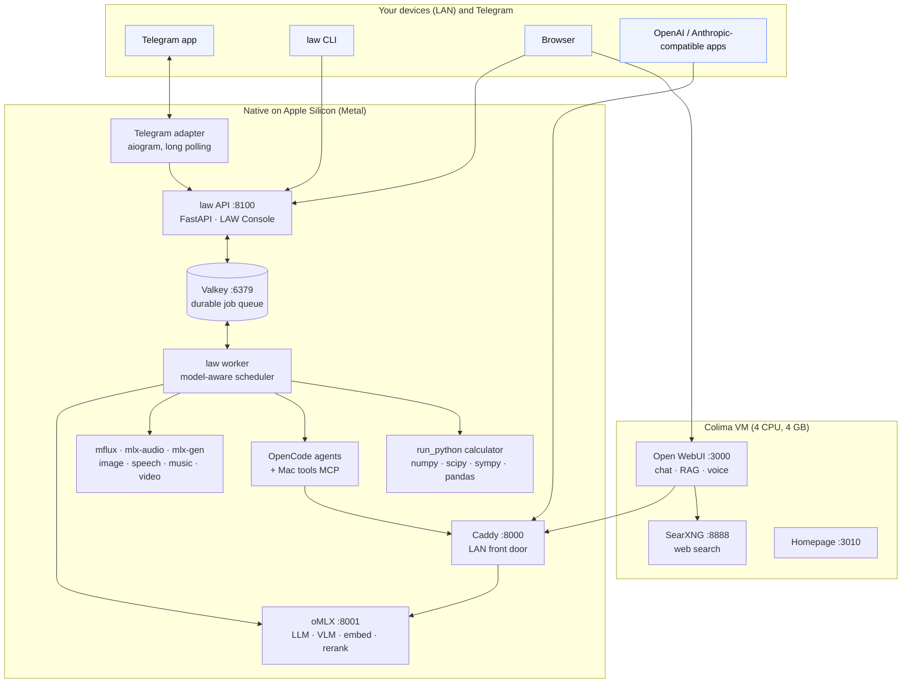
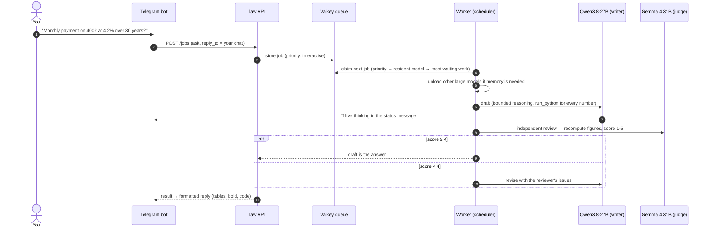

# LAW v6: Local AI Workstation

A private, free, open-source AI server for an Apple Silicon Mac (built and tested on an M5 Pro, 64 GB).
It runs strong open models locally for chat, judgement, coding, documents, image generation and editing,
speech and music, and serves them to every device on your network.

Quality comes first: answers go through a **draft → independent review → revise** loop where the reviewer
is a different model family from the writer, so the system never grades its own work.

## What you get

| Use it from | How |
|---|---|
| **Telegram** (main channel) | Message your bot: text, voice notes, photos; `/help` lists every command (`/image`, `/video`, `/music`, `/code`, `/agent`, …). Replies show live thinking |
| **Terminal** | `law ask "…"`, `law code "…"`, `law image "…"`, `law tts "…"`, `law stt file.wav`, `law music "…"`, `law jobs` |
| **Browser** (any device) | Open WebUI chat `http://<mac>.local:3000` · LAW Console `http://<mac>.local:8100` (live stats, jobs, personas, settings) · dashboard `http://<mac>.local:3010` |
| **Any OpenAI/Anthropic client** | `http://<mac>.local:8000/v1` |

Every request goes through one durable job queue with a scheduler that knows how much memory each model needs.
Big models are swapped in and out as needed, so you can use 30–45 GB models one at a time on 64 GB.

## Architecture



*(Static image: [docs/images/architecture.png](docs/images/architecture.png))*

## How a request flows



*(Static image: [docs/images/request-flow.png](docs/images/request-flow.png))*

Coding tasks follow the same idea at project scale: **translate** (the request becomes a precise brief: goal,
requirements, acceptance criteria, assumptions) → **work** (coder agent) → **review** (Gemma agent reads the code and
runs the project's checks) → **fix** if the review scores below 4/5.

Every project keeps its working memory in **`<project>/.law/`** (like `.claude/` for Claude Code): `PROMPT.md` (the
brief), `REQUESTS.md` (every request), `RESEARCH.md`, `PLAN.md` (steps with checkboxes and gates) and `PROGRESS.md`
(done, gate output, next step). The agent keeps them current and continues from them, so a session that dies
halfway picks up where it stopped; a restarted job resumes its own agent session (`.law/session.json`, git-ignored).
With no folder given, the translator names the project folder (an existing one only when you name that project) and
LAW creates it directly under `~/SourceCode/`.

## The stack

| Layer | Component | Version | Licence | Why |
|---|---|---|---|---|
| LLM runtime | [oMLX](https://github.com/jundot/omlx) | 0.7.1 | Apache-2.0 | MLX on Metal; OpenAI **and** Anthropic APIs; batching; SSD KV cache; load/unload API |
| LAN front door | Caddy | 2.11 | Apache-2.0 | Exposes the LLM API on the LAN without a key (oMLX requires one off-loopback) |
| Queue | Valkey | 9.1 | BSD-3 | Durable jobs, leases, events; Redis-compatible |
| API / CLI / worker | LAW (`src/law`) | 6.0 | — | FastAPI, Typer, pydantic; model-aware scheduler; quality loop |
| Chat UI | Open WebUI | 0.12.3 | Open WebUI licence | Chat, RAG, voice, image tools for every device |
| Search | SearXNG | 2026.10.17 | AGPL-3.0 | Private meta-search for agents and chat |
| Agents | OpenCode | 1.18 | MIT | Coding/operator agents on local models; per-role configs |
| Images | mflux | 0.23 | MIT | Qwen-Image 2.1 generate + edit, SeedVR2 upscaling |
| Workflows | ComfyUI | 0.41.3 | GPL-3.0 | Node-based image/video workflows (Metal) |
| Video | mlx-gen | 0.38 | MIT | Wan 2.2 14B text-to-video and image-to-video |
| Speech & music | mlx-audio | 0.5.9 | MIT | Kokoro TTS, Whisper STT, Chatterbox cloning, ACE-Step songs |
| Telegram | aiogram | 3.31 | MIT | Async bot, long polling (no inbound port) |
| Containers | Colima + Docker CLI | 0.10 | MIT / Apache-2.0 | Lightweight VM for the web apps |

## Models (64 GB: one large model at a time, swapped by the scheduler)

| Role | Model | Loaded size |
|---|---|---|
| Reasoning, writing, vision, coding agent (default) | Qwen3.8-27B, 8-bit | 28 GB |
| Fast coder for short tasks (32k context) | Qwen3-Coder-Next 80B MoE, 4-bit | 41 GB |
| Fast / operator | Qwen3.6-35B-A3B, 8-bit | 36 GB |
| Independent judge | Gemma 4 31B, 8-bit (different family → no self-grading) | 34 GB |
| Embeddings / rerank | Qwen3-Embedding-4B · Qwen3-Reranker-0.6B | 3 GB |
| Images | Qwen-Image 2.1 (8-bit) | ~40 GB |
| Video | Wan 2.2 A14B T2V / I2V (8-bit) | ~42 GB |
| Speech / music | Kokoro · Whisper large-v3-turbo · Chatterbox fp16 · ACE-Step 1.5 | small – 20 GB |

Exact repos and pinned revisions: `settings/registry.yaml`. Decisions and trade-offs: `docs/adr/0002-model-roster.md`.

## How quality is enforced

- **Independent judge**: a different model family scores every answer against a rubric; weak drafts are revised.
- **No mental arithmetic**: roles that handle numbers must use the `run_python` calculator; the judge recomputes figures.
- **Bounded reasoning**: each role has a reasoning effort, so the model can't think itself out of an answer.
- **Agent work is reviewed**: code and documents get a read-and-run review by the judge and a fix pass.
- **Stuck agents are caught**: a writing agent that changes no file for 25 minutes is stopped and resumed in the same
  session with a "build and fix the first error" nudge (up to 3 times, then the job fails).
- **House standard** in every role: answer first, sourced claims, no invented facts, units or currencies.
- **Measured**: `law eval` runs a verified golden set through the real product; `scripts/test_report.py` writes `docs/TEST-REPORT.md`.

## Security posture

Chosen by the owner for a home network: user-facing services are open to the LAN **without login**, and agents act with
the user's permissions (open apps, run commands). Telegram, being internet-reachable, answers only allow-listed user IDs.
Valkey and oMLX bind to loopback. Secrets live only in `~/LAW/state/.env` (mode 600). Don't run LAW on untrusted
networks (hotel or office Wi-Fi). See `docs/adr/0006-network-and-access.md`.

## Install

On a new or freshly formatted Mac with Homebrew and Python installed:

```bash
git clone <this repo> ~/SourceCode/OpenSourceLocalAI
cd ~/SourceCode/OpenSourceLocalAI/v6
./install.sh            # safe to run again any time
law doctor              # health check + the addresses to use from your other devices
```

The first run downloads about 200 GB of models. Later runs change only what differs from `settings/`.

## Set up Telegram

LAW answers through a Telegram bot that you own. It only replies to the Telegram accounts you allow.

**The easy way: `./install.sh` asks you.** Whenever Telegram isn't set up and you run `./install.sh` in a Terminal, it:

1. Asks for the **bot token** (typing is hidden). Get it from **@BotFather** in Telegram:
   `/newbot` for a new bot, or `/mybots` → your bot (e.g. "Tony") → **API Token**.
2. Checks the token with Telegram and shows the bot's name, e.g. `Connected to @TonyBot`.
3. Asks you to **send the bot any message** from your phone or Mac, then press Enter.
   It lists who just messaged the bot (e.g. `1. Alex (@alex) [id 512345678]`); pick yourself (and anyone else to allow).
4. Saves both to `~/LAW/state/.env` (readable only by you, never in the repo) and starts the bot.
5. Asks for your **report email**: where LAW sends finished documents such as `/proposal` PDFs, through this
   Mac's Mail app (no mail password is stored). Change it any time in the **LAW Console → Settings**.

Press Enter at the first prompt to skip; it will ask again on the next run.
Before you start, make sure no other program is running the same bot (an old setup or another server):
a bot can only be connected to one program at a time.

Check it with `law doctor` (should show `Telegram: configured, 1 allowed id(s)`), then send the bot `hello`.

**Manual alternative** (scripts, or changing it later):

```bash
law secrets set LAW_TELEGRAM_TOKEN 123456789:AAH...
law secrets set LAW_TELEGRAM_USER_IDS 512345678            # several: 512345678,698765432
law install
```

**What you can send**

| Message | What happens |
|---|---|
| Any text | Answered with the full quality loop (draft → independent review → revise) |
| Voice note | Transcribed, then answered |
| Photo (optionally with a caption) | Described or answered about, using the vision model |
| `/code init` | Start a **full project**: Tony sends a template (name, repo, repo URL, stack, thinking level, summary, details). Send it back filled in, and Tony researches and emails a proposal, asks **Go / No go**, sets up the tools the stack needs, builds in milestones, tests and fixes until an independent review passes, then asks you to **verify**. **Needs changes** brings an enhanced proposal (v2, v3, …) and the loop repeats until **All good**. Decide with the buttons or `/go`, `/nogo`, `/changes`, `/allgood`; `/projects` shows where each one is |
| `/code <task>` | The coding agent builds a new project in its own folder under `~/SourceCode/` (named after the project you describe) |
| `/code <folder> <task>` | Works in that project, e.g. `/code ~/SourceCode/my-app add a login page`; a new folder name (e.g. `~/SourceCode/new-app`) is created |
| `/proposal [<folder>] <request>` | A consultant-grade proposal: web research with sources, then a full document (executive summary, market, solution, technical design, architecture, user and system flows, wireframes, delivery plan, cost, risks), independently reviewed, rendered to PDF and **emailed to you**. Give a project folder to present it as the working prototype |
| `/image <prompt>` | Generates an image and sends it back |
| `/music <request>` | A full song: theme, genre/vibe and length (e.g. `2 min`). Tony writes the lyrics, or add a `lyrics:` line with your own; say `instrumental` for no vocals |
| `/film <request>` | A short film (up to 2 min): shots planned from your theme or a `script:` section, rendered with fast Wan 2.2, scored and cut together. Say `no music` to skip the score |
| `/agent <role> <task>` | Runs a role, e.g. `/agent architect design a payments API` or `/agent operator play jazz on Spotify` |
| `/jobs [project or keyword]` | What's running and its health: 🟢 working, 🔵 thinking, 🟠 stalled/stuck, 🔴 failed. With a keyword: the step, last action, to-do progress and model activity, with **Retry / Skip / Restart / Cancel** buttons |
| `/retry <job>` | Run a failed job again from the step that failed (earlier work is kept). Every failed job also asks you **Retry / Skip** with buttons |

A status message updates live while the job runs. Messages from accounts that aren't on your list are ignored.

**Change or remove later:** run `law secrets set …` again, then `law install`. To move to a new Mac, `law secrets export ~/Desktop/law-secrets.env`
saves the token and IDs to a file you keep privately; on the new Mac run `./install.sh --secrets ~/Desktop/law-secrets.env`.

**Troubleshooting:** no reply → `law services logs telegram`. "Conflict: terminated by other getUpdates request" means another program
is still using the same bot (step 3).

## Use this Mac as an offline AI server for other machines

Everything LAW needs runs on this Mac, so another laptop on the same Wi-Fi can use its AI to write code **with no
internet at all** (for example a home router that isn't connected to the internet). Verified on 2026-10-20 by running
OpenCode in a sandbox with internet blocked: it wrote and tested code using only this Mac's model.

### Before you go offline (once, on the other machine, with internet)

1. Install **OpenCode** (the coding agent): `brew install opencode` (macOS/Linux) or `npm install -g opencode-ai` (any OS).
2. Install the tools your projects need (Python, Node, JDK, `pytest`, `npm install` in each project, …).
   Offline, the AI can still write code, but **nothing can be downloaded**, so dependencies must already be there.
3. Optional: VS Code with the **Continue** extension (see below), also installed while online.

### At home without internet

1. Connect both machines to the same Wi-Fi.
2. On this Mac, check the server is up and note its address:

   ```bash
   law doctor        # all "up"; the address is shown under "LAN access"
   ```

   The Mac's name is `<mac-name>.local` (e.g. `my-macbook.local`); it works without internet
   (Bonjour). If the name doesn't resolve, use the IP address from `law doctor` instead.
3. On the other machine, run the one-line setup this Mac serves (writes the OpenCode config and settings into your shell
   profile; safe to run again):

   ```bash
   curl -fsSL http://<mac-name>.local:8100/client/install.sh | sh
   ```

4. Open a **new** terminal on the other machine, go to your project and start the agent:

   ```bash
   cd ~/code/my-project
   opencode
   ```

   It uses this Mac's coding model (Qwen3.8-27B) and edits the files **on the other machine**.

5. Check, if anything seems off:

   ```bash
   curl http://<mac-name>.local:8000/v1/models     # lists the models: the network path works
   ```

### VS Code (Continue extension)

In Continue's config (`~/.continue/config.yaml`):

```yaml
models:
  - name: LAW Qwen3.8 (home server)
    provider: openai
    model: qwen3.8-27b-8bit
    apiBase: http://<mac-name>.local:8000/v1
    apiKey: local
    roles: [chat, edit, apply]
```

### Claude Code (optional)

Claude Code can also use this Mac's Anthropic-compatible endpoint. Install and start it once while online, then:

```bash
export ANTHROPIC_BASE_URL=http://<mac-name>.local:8000
export ANTHROPIC_AUTH_TOKEN=local
export ANTHROPIC_MODEL=qwen3.8-27b-8bit
export ANTHROPIC_SMALL_FAST_MODEL=qwen3.8-27b-8bit
export CLAUDE_CODE_DISABLE_NONESSENTIAL_TRAFFIC=1
claude
```

OpenCode is the recommended client offline: it is open source and the setup above was tested with internet blocked.

### Good to know

- The Mac holds **one large model at a time**. While it runs a heavy job (an agent, an image or video), a request for a
  *different* large model gets a "cannot load … memory" error; retry when `law jobs` shows it finished, or use the
  model that's already loaded.
- `law code` / `law agent` jobs (and Telegram `/code`) run on **this Mac's** files in `~/SourceCode`. To work on the
  other machine's files, use OpenCode/Continue there as above.
- The `law` command also works from the other machine for non-coding jobs (images, music, questions):
  `export LAW_SERVER=http://<mac-name>.local:8100` (set by the setup script) and install `law` with
  `uv tool install --python 3.12 <path-to-v6>` while online.
- No login is needed on the LAN (owner's choice); don't run LAW on untrusted networks.

## Where things live

| Location | What | Survives a format? |
|---|---|---|
| `v6/` (git) | Code, `settings/` (models, ports, roles), `knowledge/`, `trained/`, docs | Yes, via git |
| `~/LAW/` | Models, caches, containers, generated media, logs, secrets (`state/.env`) | No, and that's fine |
| LAW Console → **Agents** | Live health of every running job (working / thinking / stalled / stuck / failed), its step, last actions, to-do progress and the model's activity, with Retry / Skip / Restart / Cancel | — |
| `<project>/.law/` | A project's brief, requests, research, plan and progress (commit it with the project) | With the project |
| `<project>/docs/proposal/` or `~/LAW/outputs/docs/` | `/proposal` research, Markdown source, diagrams, wireframes, PDF | With the project |

Disk use is bounded: the LLM's SSD prompt cache is capped by `machine.llm_ssd_cache_gb` in
`settings/registry.yaml` (default 20 GB), agent build caches (Maven, npm, Gradle, pip, uv) go to `~/LAW/cache`,
and `law reclaim` removes retired models, stale downloads and old logs.

Things you create in Open WebUI (model presets, prompts, tools, functions, knowledge-base definitions) are kept
in the repo with `law save`, which writes `settings/openwebui/`, refuses to save if it finds anything that
looks like a secret, and commits locally. `law install` on another Mac adds them back (`law restore-state` does
it on demand). Valves, chats, users and uploaded documents are not exported.

No secrets are ever stored in the repo. To reset everything machine-local: `law uninstall && rm -rf ~/LAW`.

## Docs

- [Quick start](docs/QUICKSTART.md): first 10 minutes
- [Runbook](docs/RUNBOOK.md): operate, update, troubleshoot
- [Architecture](docs/ARCHITECTURE.md) and [decision records](docs/adr/)
- [Research](RESEARCH.md): why these models and tools
