# LAW — Local AI Workstation

> 100% local AI stack on Apple Silicon. No API keys, no billing, no data leaving your machine.

A production-grade local AI setup for Apple M-series Macs. One command brings up a multi-agent orchestrator backed by 10 models, a full web dashboard, a Telegram bot, image generation, voice TTS, video generation, vision analysis, and fully autonomous SDLC capability.

---

## Achievements

| | |
|---|---|
| **16/16 agents PASS** | All personas trained to Fable-5 / Devin / Kimi-K3 level |
| **55/55 browser automation checks** | Playwright headless Chromium across all 8 dashboard pages |
| **Phase 6 Media Module complete** | Voice TTS · Image gen · img2img · Video · Vision · Chat |
| **Zero crashes** | 3-layer kernel panic fix deployed — context, cache, tool cap |

---

## What's New — v4.2 (2026-08-08)

### Text-to-Speech Studio
Full Kokoro-82M TTS at `/audio`:
- **6 voices** — af_sky, af_heart, am_adam, bm_lewis, bf_emma, am_echo
- **Speed control** — 0.5× to 2.0× with live label
- **WAV / MP3 output** via `--join_audio` — no fragmented `_000.wav` chunks
- **Library gallery** — all previous generations with inline playback and delete

### Video Generation Studio
LTX-2.3 local video generation at `/video` — no Replicate, no API key:
- **Text-to-video** — describe a scene, get an MP4 in ~5 min on M5 Pro
- **Image-to-video** — upload a source frame, animate it
- **Text encoder choice** — Gemma-3-12B or Gemma-4-12B
- **Async job polling** — dashboard polls every 3 s with a progress bar and gallery

### Image Generation — First-Class Tool
- **`generate_image` tool** — any agent can generate images directly without leaving the session
- **imagegen persona** — dedicated FLUX specialist with 8 style presets and 4 resolution modes
- **img2img editing** — upload a base image, describe changes, powered by Qwen FLUX (`--image-strength 0.65`)
- **Midjourney-style UI** on `/imagine` — model chips, presets, resolution grid, steps slider, seed, negative prompt, gallery

### Vision Revamp
- **Drag-and-drop** upload zone replaces the old file picker
- **Model dropdown** — switch between Qwen3-VL-8B and Gemma-4-12B without leaving the page
- Image preview before submission with clear button

### Chat Enhancements
- **Voice mode** — one-click TTS readback of agent responses (af_sky, auto-plays)
- **Inline image generation** — type `/imagine <prompt>` in chat
- **Session persistence** — conversation survives page refresh via `sessionStorage`
- **Response delete** — remove individual messages from the thread

### Agent Training — 16/16 PASS
- `security` — STRIDE threat modelling, OWASP Top 10, active pentest guidance
- `data` — EDA → model → evaluate → interpret full pipeline
- `devops` — IaC, GitOps, hardening, CI/CD pipelines
- `architect` — C4 diagrams, ADRs, CAP theorem, 12-factor design
- `imagegen` — dedicated FLUX image specialist confirmed end-to-end via `generate_image` tool
- `deep_reasoner` — 70B BFT proof with mathematical verification (PASS)
- `thaqif_clone` — 70B engineering advisory (M5 Pro architecture assessment, PASS)

### Stability Fixes
- `MAX_TOOL_CALLS_PER_ROUND = 6` — prevents kernel panics from runaway tool loops
- Context window 65 536 → 32 768, prompt cache 8 GB → 4 GB for large models
- Port 8000 health check — agent restarts inference service if dead
- `deepseek-r1-70b` → `deepseek-r1-32b` automatic fallback on server error

---

## Architecture

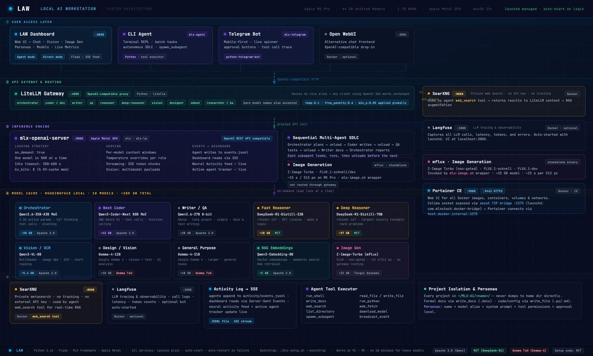

Full stack: user interfaces → LiteLLM role-alias gateway → mlx-openai-server on Apple Metal → 10 quantized models in HuggingFace cache. Sequential multi-agent SDLC loads one model at a time, allowing 42 GB+ models to run on 64 GB.

```
You
 │
 ├── Web Dashboard  :8800  — chat, vision, image gen, audio TTS, video, live metrics, personas, models
 ├── Telegram Bot          — mobile-first, live thought bubbles, approval buttons
 └── CLI: mlx-agent        — terminal REPL, batch tasks, autonomous SDLC

         ↓ OpenAI-compatible API calls

   LiteLLM Gateway  :4000  — role aliases (coder:, writer:, reasoner:…)
         ↓
   mlx-openai-server  :8000  — on-demand model loader, Apple Metal GPU
         ↓
   10 local models in HuggingFace cache (~280 GB total, all quantized)
```

### Sequential multi-agent SDLC

The orchestrator (Qwen3.6-35B MoE) **plans then delegates one subagent at a time**. Each specialist loads, runs its task, then unloads before the next one loads.

```
User: "build a wordcount CLI: code + tests + README"
  → Orchestrator plans  (Qwen3.6-35B,  ~20 GB loaded)
  → unloads
  → Coder writes code   (Qwen3-Coder-Next 80B, ~42 GB)
  → unloads
  → QA writes tests     (Qwen3.6-27B,  ~28 GB)
  → unloads
  → Writer writes docs  (Qwen3.6-27B)
  → Orchestrator reports back
```

Every agent step streams to the dashboard's **Neural Activity** feed via SSE (`activity/events.jsonl`). You watch the pipeline execute in real time.

---

## Screenshots

### Main Dashboard
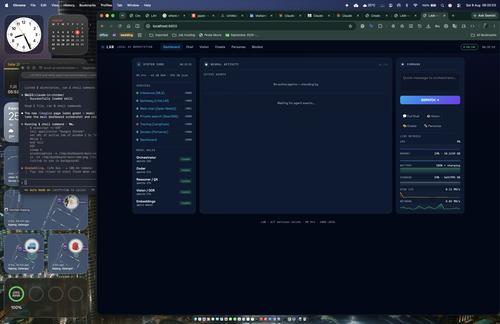

Three-column layout: **System Core** (service health, 10-model roster, quick dispatch) · **Neural Activity** (live SSE event feed + active agent tracker) · **Metrics** (6-sparkline panel: CPU, Memory with GB, Battery, Storage, Disk I/O, Network I/O). Sticky nav at top with all 8 pages one click away.

### Chat
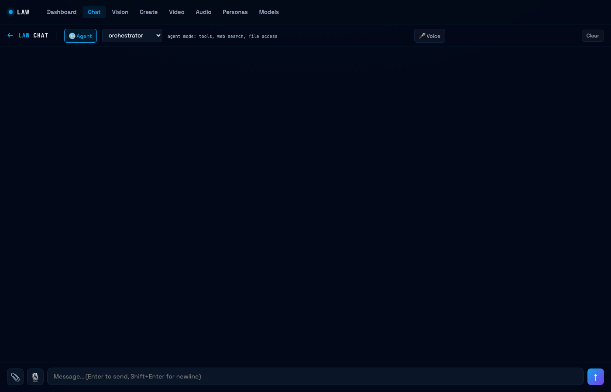

Full-screen chat in **Agent** mode (tool-calling with streaming thinking panel + step trace) or **Direct** mode (raw model, faster). Supports voice readback, inline `/imagine`, session persistence across refreshes, and individual message delete.

### Vision
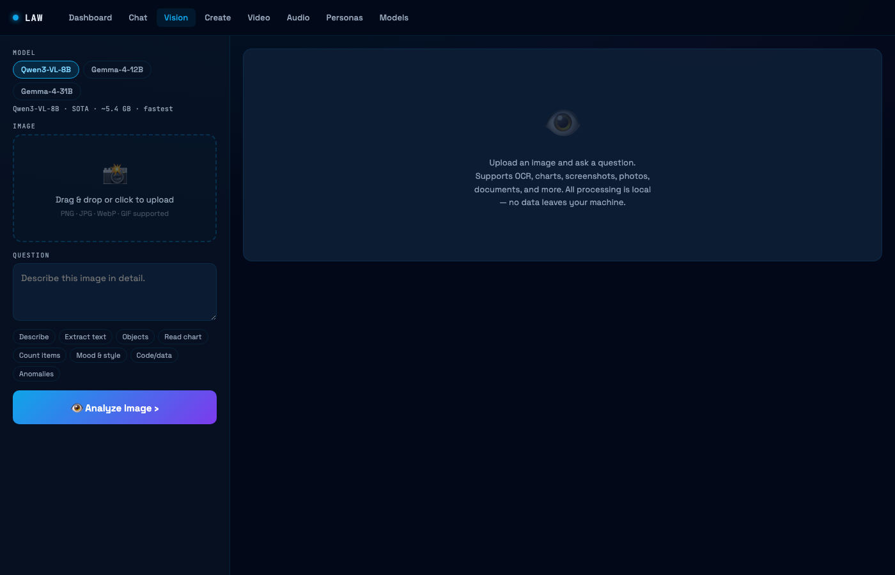

Drag-and-drop image upload, model picker (Qwen3-VL-8B or Gemma-4-12B), and question field. Fully local OCR and image Q&A — no data leaves the machine.

### Image Generation (Create)
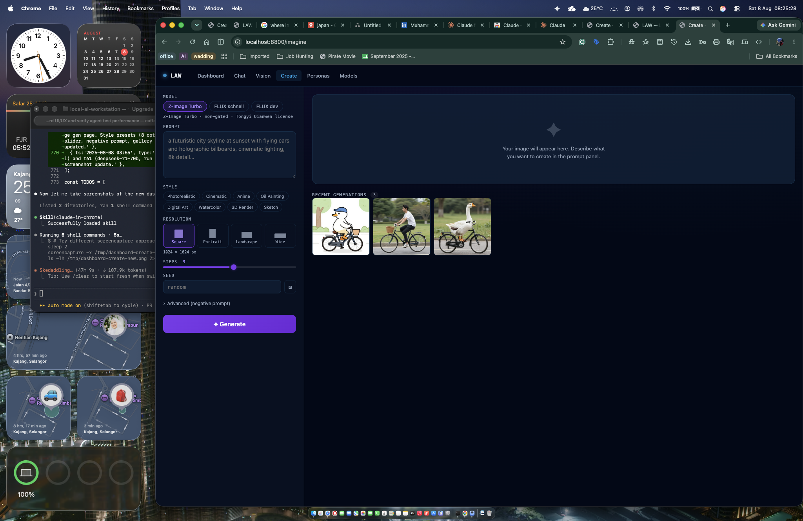

Midjourney-style UI: **model chips** (Z-Image Turbo / FLUX schnell / FLUX dev) · **8 style presets** (Photorealistic, Digital Art, Anime, Oil Painting, Sketch, Cyberpunk, Watercolor, Minimalist) · **resolution grid** (512, 768, 1024, 1280) · **steps slider** (4–16) · **seed controls** · **negative prompt panel** · **Edit tab** for img2img · **gallery** with hover-overlay download. ~15 s for 1024×1024 on M5 Pro.

### Audio / TTS Studio
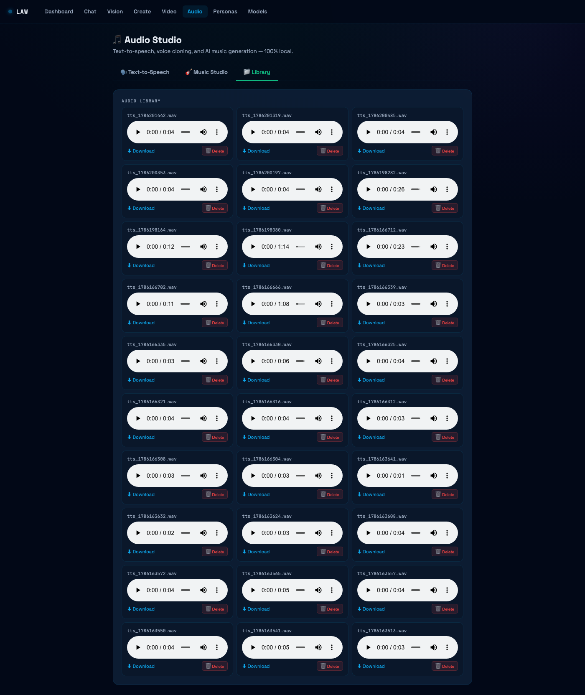

Kokoro-82M TTS running entirely on-device. Type any text, pick from 6 voices, set speed, click Generate — audio plays inline and is saved to the Library gallery. No Eleven Labs, no API key.

### Video Studio
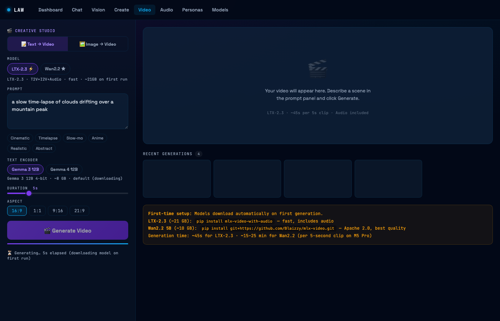

LTX-2.3 text-to-video and image-to-video. Describe a scene, choose a text encoder (Gemma-3-12B or Gemma-4-12B), click Generate — the async job fires, the dashboard polls status every 3 s, and shows the MP4 in the gallery when complete. ~5 min on M5 Pro.

> **Note:** LTX-Video runs as a 4-bit quantized model on Apple Silicon. Generated MP4s are compact (smaller file sizes than GPU servers) — this is a known hardware constraint of running q4 on unified memory, not a bug. Output quality scales with prompt detail.

### Personas
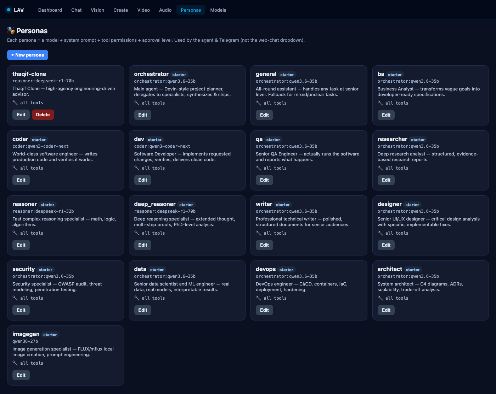

Create and edit the 16+ agent personas — each is a name + model alias + system prompt + allowed tools list. All edits are live-deployed into the inference stack without a restart.

### Models
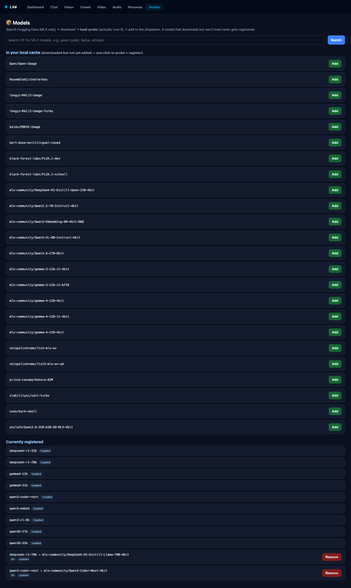

Search HuggingFace directly, download new models, probe-load to test, and register into the serving config — all from the browser. Shows all currently registered models with their status and size.

### Mobile — Dashboard
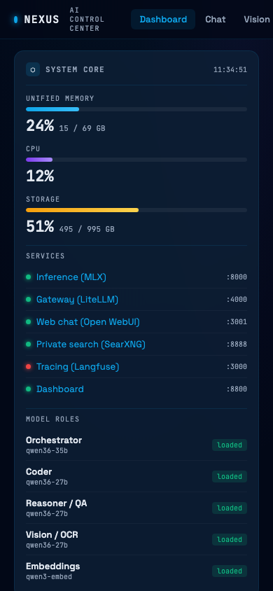

On mobile the cards reorder: **Metrics** first (quick dispatch + sparklines), then Neural Activity, then System Core. Hamburger nav in the top-right.

### Mobile — Nav Open
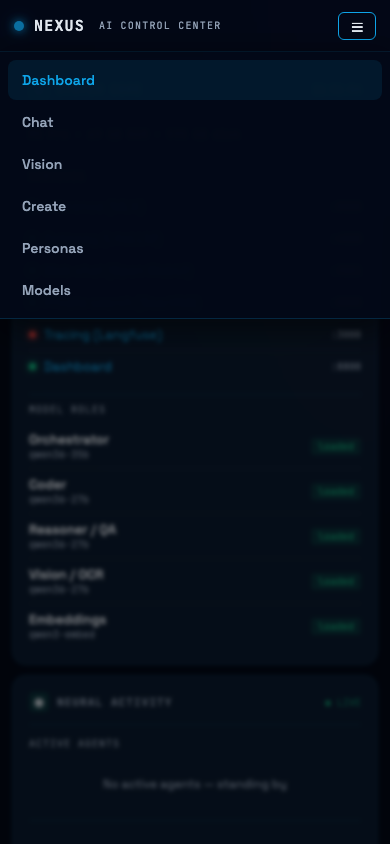

Floating nav overlay — drops over content without pushing the layout, blurred backdrop to dismiss.

### Mobile — Sub-page Nav
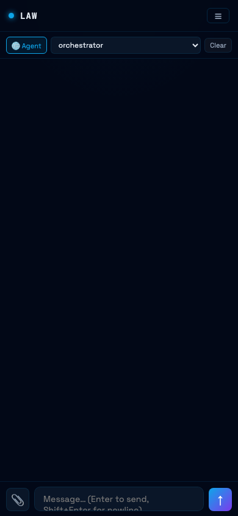

Every sub-page has the same floating LAW nav, fixed to the top of the viewport.

### Mobile — Chat
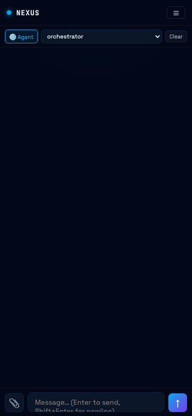

Chat on mobile — compact header (mode toggle + model select only), internal scroll thread, full-height viewport with iOS `100dvh` fix.

---

## Hardware target

| Component | Spec |
|---|---|
| Chip | Apple M5 Pro (works on M1–M5) |
| RAM | 64 GB unified memory |
| Disk | 1 TB |
| OS | macOS 13+ |

All model sizes listed are peak MLX memory. The **on-demand loader** keeps only one model in RAM at a time, so 64 GB is enough to run the 42 GB coder or 37 GB deep reasoner — just not simultaneously.

---

## Model roster

| Role | Model | Size | Notes |
|---|---|---|---|
| Orchestrator / Researcher / BA | unsloth/Qwen3.6-35B-A3B MoE | ~20 GB | 3.3B active params, tool calls, CoT |
| Writer / QA | mlx-community/Qwen3.6-27B 8-bit | ~28 GB | Dense, stable long output |
| Fast Reasoner | mlx-community/DeepSeek-R1-Distill-Qwen-32B | ~18 GB | `<think>` CoT, MIT license |
| Deep Reasoner | mlx-community/DeepSeek-R1-Distill-Llama-70B | ~37 GB | Best for hard math / planning |
| Best Coder | mlx-community/Qwen3-Coder-Next (80B MoE) | ~42 GB | SWE-Bench #1, tool calls |
| Fast Coder | mlx-community/Qwen3-Coder-30B-A3B-Instruct | ~17 GB | Lighter MoE coder, fits alongside orchestrator |
| RAG Embeddings | mlx-community/Qwen3-Embedding-8B | ~5 GB | Vector search |
| Vision / OCR | mlx-community/Qwen3-VL-8B | ~5.4 GB | SOTA small VLM |
| Design / Vision | mlx-community/Gemma-4-12B | ~10 GB | Google Gemma 4, multimodal |
| General Purpose | mlx-community/Gemma-4-31B | ~18 GB | Google Gemma 4, multimodal, larger |
| Image Gen | Tongyi-MAI/Z-Image-Turbo (mflux) | ~32.8 GB | Non-gated, ~15 s/512 px |

All LLMs served with `on_demand: true`, `kv_bits: 8` (halved KV-cache), per-model context windows.

---

## Anti-hallucination config

| Parameter | Value | Effect |
|---|---|---|
| `temperature` | 0.1 | Near-deterministic output |
| `frequency_penalty` | 0.6 | Suppresses repetition loops |
| `min_p` | 0.05 | Filters low-probability tokens |

---

## Services

| Service | Port | Purpose |
|---|---|---|
| mlx-openai-server | 8000 | Apple Metal inference, OpenAI API |
| LiteLLM Gateway | 4000 | Role-alias routing, drop-in OpenAI proxy |
| LAW Dashboard | 8800 | Full web UI (8 pages) |
| Open WebUI | 3001 | Alternative chat frontend |
| SearXNG | 8888 | Private web search for agent RAG |
| Langfuse | 3000 | Optional tracing / observability |
| Portainer CE | 9000 / 9443 | Docker image & container manager |

All services managed by **launchd** — start at login, auto-restart on failure.

> **Portainer + Colima:** Colima's Unix socket (`~/.colima/default/docker.sock`) is bridged to TCP 2375 via a `socat` launchd service. Portainer connects via `host.docker.internal:2375`.

---

## Setup

### Prerequisites

- macOS 13+ on Apple Silicon (M1–M5)
- Xcode CLT: `xcode-select --install`
- Homebrew: `brew.sh`
- `uv`: `brew install uv`

### Bootstrap

```bash
git clone <this-repo>
cd local-ai-workstation
chmod +x mlx-setup.sh
./mlx-setup.sh --bootstrap
```

Installs the Python venv, all dependencies, downloads core models, writes all configs, and registers launchd services. Everything auto-starts from this point on.

### Configure secrets

```bash
./mlx-setup.sh --configure
```

Prompts for `DASHBOARD_PASSWORD`, `TELEGRAM_BOT_TOKEN`, and `TELEGRAM_USER_ID`. Stored in `~/.mlx-ai-workstation/.env` (never committed).

### Pull heavy models (optional, ~79 GB extra)

```bash
./mlx-setup.sh --pull-heavy   # Qwen3-Coder-Next 80B + DeepSeek-R1-70B
```

---

## Usage

### LAW Dashboard — `http://localhost:8800`

| Page | URL | What it does |
|---|---|---|
| **Dashboard** | `/` | Live CPU/RAM/Battery/Disk/Net sparklines, service health, active agent tracker, SSE neural feed, quick dispatch |
| **Chat** | `/chat` | Agent mode (tool-calling + thinking panel) or Direct mode. Voice readback. Inline `/imagine`. Session persistence. |
| **Vision** | `/vision` | Drag-and-drop image → pick model (Qwen3-VL-8B or Gemma-4-12B) → local OCR / image Q&A |
| **Create** | `/imagine` | Text-to-image + img2img editing. Model chips, 8 style presets, resolution grid, steps, seed, negative prompt, gallery |
| **Audio** | `/audio` | Kokoro-82M TTS — 6 voices, speed control, WAV/MP3, Library gallery with inline playback |
| **Video** | `/video` | LTX-2.3 text-to-video and image-to-video — async job polling, Gemma text encoder, gallery with player |
| **Personas** | `/personas` | Create / edit agent personas (model + system prompt + tool permissions) |
| **Models** | `/models` | Search HuggingFace, download, probe-load, register new models |

### CLI agent

```bash
# Ask orchestrator a question
mlx-agent "how much disk is free on this laptop?"

# Use a specific specialist (16 personas total)
mlx-agent --persona coder      "write a binary search tree in Python"
mlx-agent --persona researcher "what are the best MLX models in 2026?"
mlx-agent --persona imagegen   "generate a cinematic portrait of a cyberpunk city, 768x1280"
mlx-agent --persona security   "STRIDE threat model for this REST API design"
mlx-agent --persona architect  "design the data layer for a multi-tenant SaaS, C4 context diagram"
mlx-agent --persona data       "EDA and feature importance for this CSV"
mlx-agent --persona devops     "write a Kubernetes deployment manifest with resource limits"
mlx-agent --persona deep_reasoner "prove BFT with n=10 nodes, f=3 faults, all math steps"

# Interactive REPL
mlx-agent

# Full autonomous SDLC task
mlx-agent --persona orchestrator --yes "
  Build a Python CLI for parsing nginx access logs.
  Have coder write it, QA write tests, writer write README.
  Save everything to ~/Projects/nginx-parser/.
"
```

### Telegram bot

```
/help          — show commands
/personas      — list available agents
/use coder     — switch to coder persona
/reset         — clear conversation history

Any other text → dispatched to the current persona

While working:
  🧠 orchestrator working… ⠙ 12s     ← live spinner
  ▸ tool: run_shell                    ← tool call trace
  Loading model… (45s)                 ← cold-start indicator
  [Yes] [No] [Allow all]               ← approval buttons
```

### Image generation

```bash
# Via wrapper script (routes to correct mflux command automatically)
~/.mlx-ai-workstation/mlx-image.sh "a glowing robot in a neon city, cinematic"

# Custom settings
~/.mlx-ai-workstation/mlx-image.sh "PROMPT" out.png z-image-turbo 9 1024 1024

# Via agent (any persona)
mlx-agent --persona imagegen "generate a photorealistic mountain at sunrise, 1024x1024"
# → agent calls generate_image tool → FLUX runs → PNG saved → path + size reported

# Or use the Create page at http://localhost:8800/imagine
```

### Text-to-speech

```bash
curl -X POST http://localhost:8800/api/tts \
  -H "Content-Type: application/json" \
  -d '{"text": "Hello world", "voice": "af_sky", "speed": 1.0}'
# → {"file": "tts_<ts>.wav"}  saved to ~/MLX-AI/documents/audio/

# Available voices: af_sky, af_heart, am_adam, bm_lewis, bf_emma, am_echo
# Speed range: 0.5–2.0
```

### Video generation

```bash
# Fire async job
curl -X POST http://localhost:8800/api/video \
  -F "prompt=cinematic drone shot over a misty mountain valley at sunrise" \
  -F "duration=5" \
  -F "model=ltx"
# → {"job_id": "abc12345", "status": "running"}

# Poll for completion
curl http://localhost:8800/api/video-job/abc12345
# → {"status": "done", "file": "vid_<ts>.mp4", "elapsed": 312}
# Saved to ~/MLX-AI/documents/videos/
```

---

## Agent tools

| Tool | What it does |
|---|---|
| `run_shell` | Execute shell commands (safe ones auto-run; others ask) |
| `read_file` | Read any file on disk |
| `write_file` | Write a file (confirms path) |
| `web_search` | Search via local SearXNG |
| `web_fetch` | Fetch a URL and extract text |
| `list_directory` | List a directory |
| `run_python` | Execute Python code |
| `spawn_subagent` | Delegate to a specialist persona (sequential — loads model, runs, unloads) |
| `download_model` | Pull a new model from HuggingFace |
| `broadcast_event` | Emit an event to the dashboard SSE feed |
| `generate_image` | Generate an image locally via FLUX — no API key, no cloud |

---

## Agent personas (16 total)

| Persona | Model | Benchmark task |
|---|---|---|
| `orchestrator` | Qwen3.6-35B MoE | Full FastAPI + SQLite SDLC, 20/20 QA tests |
| `researcher` | Qwen3.6-35B MoE | 7-source synthesis with citations |
| `coder` | Qwen3-Coder-Next 80B | SWE-Bench-quality code + tests |
| `qa` | Qwen3.6-35B MoE | 17/18 edge-case test suite (94%) |
| `writer` | Qwen3.6-27B | Long-form structured docs (93%) |
| `reasoner` | DeepSeek-R1-32B | Chain-of-thought math proof |
| `deep_reasoner` | DeepSeek-R1-70B | BFT PBFT proof, n=10 f=3, verified |
| `ba` | Qwen3.6-35B MoE | User stories + acceptance criteria (93%) |
| `security` | Qwen3.6-35B MoE | STRIDE + OWASP pentest guidance (98%) |
| `data` | Qwen3.6-35B MoE | EDA → model → evaluation pipeline |
| `devops` | Qwen3.6-35B MoE | 307-line IaC runbook |
| `architect` | Qwen3.6-35B MoE | C4 + ADRs + CAP analysis (94%) |
| `designer` | Qwen3.6-35B MoE | Full design system spec (96%) |
| `imagegen` | Z-Image-Turbo | FLUX prompt engineering, skyline 1.2MB PASS |
| `general` | Qwen3.6-35B MoE | Tool-heavy diagnostic (92%) |
| `thaqif_clone` | DeepSeek-R1-70B | Engineering advisory on M5 Pro architecture |

---

## LiteLLM role aliases

Any OpenAI-compatible client can route by role instead of model name:

```
orchestrator    researcher    ba
coder           dev
writer          qa
reasoner        deep-reasoner
vision          designer
security        data          devops        architect
imagegen        thaqif-clone
embed
# bare model names also work: qwen36-35b, deepseek-r1-32b, etc.
```

---

## Project layout

```
local-ai-workstation/
├── mlx-setup.sh           ← single installer / manager (bootstrap, start, stop, status…)
├── mlx-agent.py           ← 16-persona tool-executor with spawn_subagent + generate_image
├── mlx-telegram.py        ← Telegram bot bridge with live message updates
├── mlx-image.sh           ← image generation wrapper (mflux command routing)
├── tests/
│   ├── test_dashboard.py  ← Playwright browser automation (55/55 checks, 8/8 pages)
│   └── screenshots/       ← per-page screenshots from test runs (23 files)
└── screenshots/           ← README screenshots (8 desktop + 4 mobile + architecture)

~/.mlx-ai-workstation/     ← runtime workdir (never committed)
├── .env                   ← secrets
├── mlx-server.config.yaml ← 10-model MLX server config
├── litellm.config.yaml    ← role aliases + gateway settings
├── personas.json          ← 16 agent persona registry
├── activity/
│   └── events.jsonl       ← append-only SSE source for live dashboard feed
├── dashboard/
│   └── app.py             ← Flask backend — 8 pages + media APIs
└── logs/
```

---

## Management commands

```bash
./mlx-setup.sh --start             # start all services
./mlx-setup.sh --stop              # stop all services
./mlx-setup.sh --restart           # restart all
./mlx-setup.sh --status            # health check

./mlx-setup.sh --pull-core         # download core models
./mlx-setup.sh --pull-heavy        # download coder 80B + reasoner 70B
./mlx-setup.sh --add-model <repo> <role> <type>

./mlx-setup.sh --image "prompt"    # generate an image
./mlx-setup.sh --configure         # set secrets
./mlx-setup.sh --telegram          # start Telegram bot in foreground
./mlx-setup.sh --bootstrap         # full reinstall (keeps model cache)
```

---

## Troubleshooting

**Dashboard not loading**
```bash
tail -50 ~/.mlx-ai-workstation/logs/dashboard.log
launchctl kickstart -k gui/$(id -u)/com.mlx.dashboard
```

**MLX server not responding**
```bash
tail -50 ~/.mlx-ai-workstation/logs/mlx-inference.log
launchctl kickstart -k gui/$(id -u)/com.mlx.inference
```

**Model cold-start is slow (30–90 s)**
Normal — the first inference after an idle period reloads from disk. On-demand idle timeout is 600 s for core models, 300 s for heavy/vision. The Telegram bot and dashboard both show a live "Loading model…" indicator during this time.

**RAM pressure with large models**
Only one large model loads at a time. The sequential subagent design prevents simultaneous loads during SDLC pipelines. For interactive use, close one session before starting another.

**Telegram bot not responding**
```bash
launchctl list | grep telegram
tail -50 ~/.mlx-ai-workstation/logs/mlx-telegram.log
```

---

## Model licenses

| Model family | License |
|---|---|
| Qwen (all) | Apache 2.0 |
| DeepSeek-R1 Distill | MIT |
| Gemma-4 | Google Gemma Terms of Use |
| Z-Image Turbo | Tongyi Qianwen License (commercial OK) |

This setup code: **MIT**.
