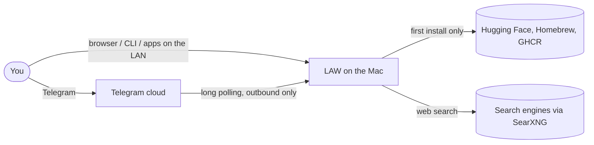
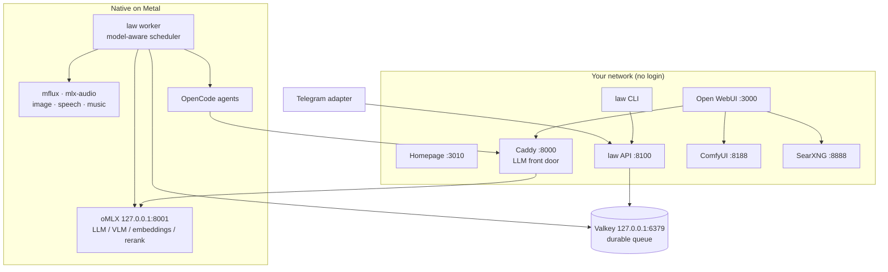

# Architecture

## Context (C4 level 1)

## Containers (C4 level 2)

Open WebUI, SearXNG and Homepage run in a small Colima VM (4 CPU, 4 GB). Everything that needs the GPU runs natively.

## Request flow

1. A client (Telegram, CLI, another device) posts a job to the API.
2. The API resolves which model the job needs and how much memory, then stores it in Valkey.
3. The worker's scheduler picks the next job:
   - priority first (interactive > normal > batch), with ageing so nothing starves;
   - within a priority, prefer the model already loaded, then the model with the most waiting work (fewest swaps);
   - one heavy job at a time; light jobs (speech, embeddings) run alongside while memory allows.
4. Before a heavy job the worker unloads other large models through oMLX, so a 40 GB image model never collides with a 34 GB LLM.
5. `ask` jobs run as a pipeline: **draft** (Qwen3.8-27B) → **judge** (Gemma 4, a different family) → **revise** only if the score is below 4/5.
6. Progress events stream back to the client; results land in `~/LAW/outputs/`.

Crash safety: running jobs hold a lease. If the worker dies, its jobs return to the queue with their original age; retries back off, and jobs that keep failing go to a dead-letter set.

## Memory budget (64 GB)

| Slot | GB |
|---|---|
| macOS and apps | 12 |
| Docker VM | 4 |
| Models (one heavy + light) | 48 |

## Non-functional requirements

| Requirement | How it is met | Verified by |
|---|---|---|
| Accuracy over speed | Largest quants that fit; independent judge; revise loop | Integration test (judge family), eval suites |
| Reproducible install | Registry + pinned revisions + `brew bundle` + `uv.lock` | Re-run tests (0 changes), fresh-machine test |
| Re-runnable | Each step plans from real state; lock; resumable downloads | Unit tests for the six re-run guarantees |
| Single data root | `~/LAW` for everything machine-local; env vars point tools there | Wipe and placement checks |
| No secrets in git | `.env` only in `~/LAW/state`; gitleaks | Secret-scan tests |
| LAN access without login | Services bind `0.0.0.0`; oMLX stays on loopback behind Caddy | Integration test on the LAN IP |
| Recoverable | Leases, retries, dead letters, launchd KeepAlive | Worker crash-recovery tests |

## Security posture

Decided by the user (ADR-0006): services are open to the local network without login, and agents act with the user's full permissions.
Consequences are documented in the ADR. Telegram is restricted to allow-listed user IDs because it is reachable from the internet.
Valkey and oMLX bind to loopback only.

See `docs/adr/` for each decision and the alternatives considered.
